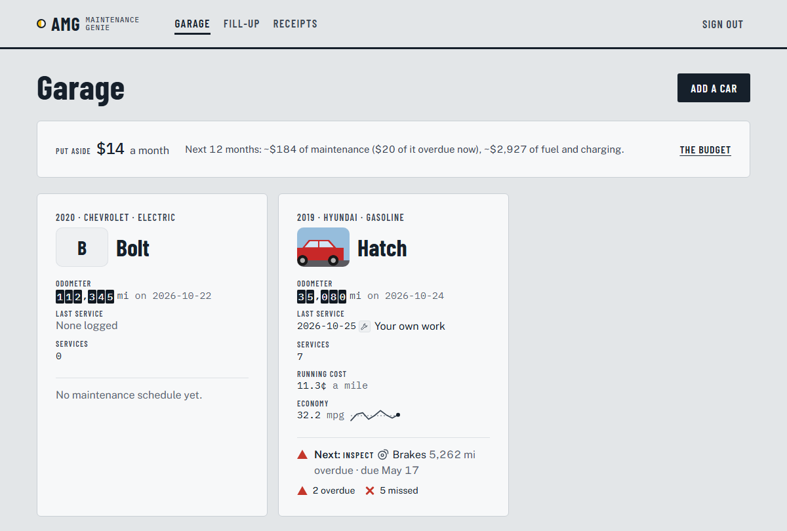
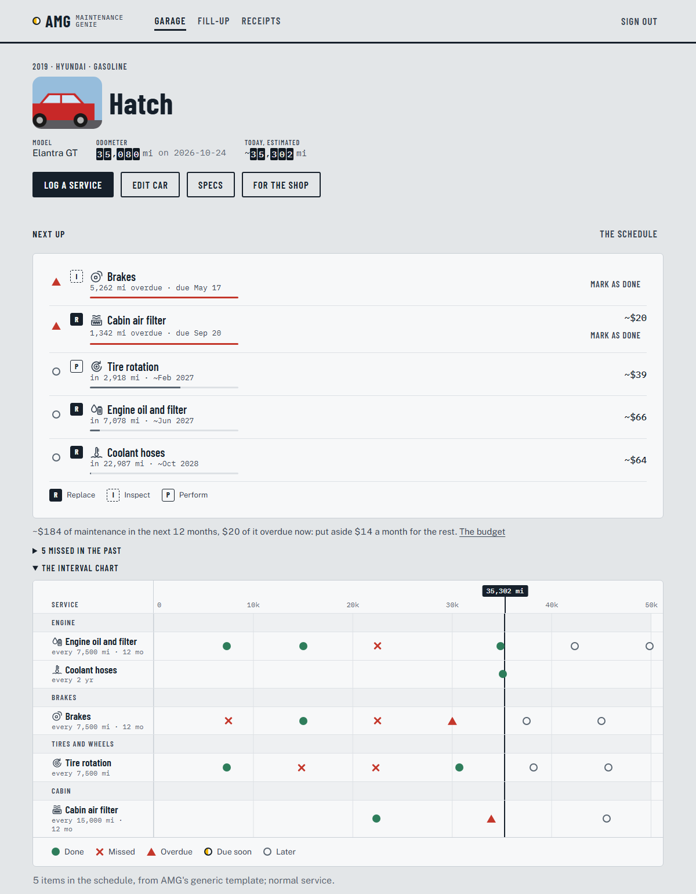
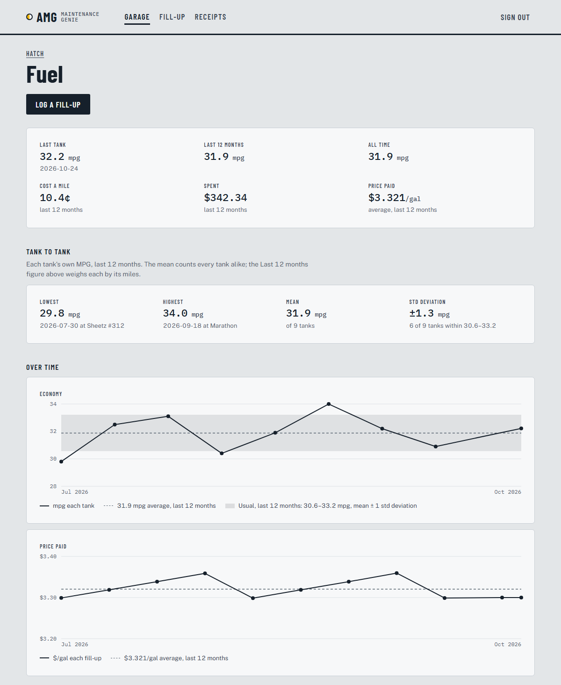

# AMG — the Automobile Maintenance Genie

A self-hosted web app that keeps your cars' maintenance. It reads your scanned
service receipts, checks them against the maker's schedule, and tells you what
was missed, what's next, and what it will cost.



## What it does

- **Reads your receipts.** Upload scans or phone photos (PDF, PNG, JPG or GIF,
  several at once). Claude reads each one into dated line items, along with the
  shop and the odometer. Nothing counts until you've checked it against the
  scan beside it, and every field stays correctable afterwards.
- **Knows the schedule.** The schedule comes from the owner's manual (a PDF Claude
  reads and you confirm), from a draft Claude writes from the year, make and
  model, or from a generic template. Normal or severe service.
- **Finds the gaps.** Each job's history goes on one interval chart: done,
  missed, overdue, due soon. **Next up** says what's due by miles or months,
  using today's mileage as estimated from your readings and fill-ups.
- **Budgets for it.** It shows what the next 12 months of maintenance, fees and
  fuel will cost, and what to put aside each month. It also shows what each car
  costs a mile to run, year by year.
- **Logs fuel and charging.** A form for your phone at the pump shows economy
  tank to tank, the price you paid over time, and how the stations you use
  compare. Electric cars count kWh and mi/kWh instead.
- **Keeps track of the rest:**
  - inspection and registration dates
  - safety recalls, from NHTSA
  - work a shop recommended
  - problems you've noticed, gathered on one sheet for the shop with what's due
  - warranties
  - the oil, filters, tires and bulbs each car takes
- **Tells you.** It sends a push to your phone (through [ntfy](https://ntfy.sh))
  when something falls due, a weekly email, and a calendar file you can import.
- **Hands it over.**
  - history, spending and fuel reports, with CSVs
  - a sale packet: one PDF of a car's history and every receipt, for a buyer
  - **Download your data**
  - backups you can restore

| A car | Its fuel |
|---|---|
|  |  |

## Run it

You need Python 3.12 or later. Tesseract OCR is optional: it makes scans
searchable, and AMG runs without it.

```bash
python -m venv .venv
.venv/bin/python -m pip install -e ".[dev]"      # Windows: .venv\Scripts\python
cp .env.example .env                              # then add your ANTHROPIC_API_KEY
.venv/bin/python -m amg.cli set-password
.venv/bin/python -m uvicorn amg.app:app --reload
```

Open http://127.0.0.1:8000 and sign in. Everything AMG keeps goes in `data/`:
the SQLite database, the files you upload, and backups. Set `AMG_DATA_DIR` to
put it somewhere else.

Run the tests with `.venv/bin/python -m pytest`.

## Settings

`.env.example` lists every setting with what it does. These are the ones you're
most likely to set:

| Setting | What it's for |
|---|---|
| `ANTHROPIC_API_KEY` | Reading receipts, manuals and spec pages. Without it AMG still runs, but can't read what you upload |
| `AMG_CLAUDE_MODEL` | The model that reads them; `claude-opus-5-5` by default |
| `AMG_DATA_DIR` | Where the data lives; `data/` by default |
| `AMG_NTFY_TOPIC` | Pushes to your phone. Make it long and random: ntfy topics are open to anyone who knows the name |
| `AMG_SMTP_USER`, `AMG_SMTP_PASSWORD` | The weekly email, sent through Gmail with an app password |
| `AMG_BASE_URL` | Where links in pushes and emails point |
| `AMG_COOKIE_SECURE` | Send the login cookie over HTTPS only. Turn it on once AMG is served over HTTPS |

## From the command line

`python -m amg.cli <command>`. On the server, it's `amg <command>`.

| Command | What it does |
|---|---|
| `set-password` | Sets the login password, and signs out every session |
| `backup [--no-files] [--out PATH]` | Zips the database and the stored files into `data/backups/` |
| `restore FILE.zip --replace` | Puts a backup back in place (stop the app first) |
| `alerts --dry-run` | Prints what today's alerts run would push and email, and sends nothing |
| `migrate` | Applies database migrations; the app also does this when it starts |

## Deploying

AMG is built for a home lab: a Proxmox container running the app behind
nginx, reached at home or over a VPN. A systemd timer runs the alerts each
morning. [docs/DEPLOY-proxmox.md](docs/DEPLOY-proxmox.md) walks through it
from an empty container. After that, `bash scripts/deploy.sh` ships each change
from WSL. It reads where to deploy from `.env.deploy`, which git ignores.

AMG has one user and one password. It's made for a home network or a VPN, not
the open internet. If you do put it there, serve it over HTTPS and set
`AMG_COOKIE_SECURE=1`.

## What leaves your network

- Receipts, manuals and spec pages you upload go to Anthropic's API to be
  read. Claude is also asked for job prices when your receipts haven't shown
  them.
- VINs go to NHTSA to be decoded, and each car's year, make and model to check
  for recalls.
- Station and shop icons are fetched from their own websites. When a site turns
  AMG away, DuckDuckGo's icon service is asked instead, and it's told only the
  website's name.
- Pushes go through ntfy, and the weekly email through your mail provider.

Everything else stays in `data/` on your own machine.

## How it's built

- **Stack:** Python, FastAPI and Jinja2. htmx and Alpine.js are vendored, so there's no JavaScript build step.
- **Storage:** SQLite through the standard library, with numbered migrations.
- **Documents:** PyMuPDF for PDFs, Tesseract for OCR, and Claude, through the Anthropic SDK, for reading documents.

| Where | What |
|---|---|
| `src/amg/web/` | Routes, templates, styles |
| `src/amg/repo/` | All the SQL |
| `src/amg/engine/` | The arithmetic: odometer model, schedule gaps, forecasts, fuel, with no database or I/O |
| `src/amg/ingest/` | Getting information in: PDFs, OCR, Claude's readings, NHTSA |
| `src/amg/reports/` | Reports, CSVs, the sale packet, Download your data |
| `src/amg/alerts/` | The daily run: pushes, the weekly email, the calendar file |
| `tests/` | Mirrors `src/` |

## More

- [docs/SPEC.md](docs/SPEC.md) says what AMG is for.
- [docs/ROADMAP.md](docs/ROADMAP.md) gives the build phase by phase: the decisions, what each phase owns, and what its tests pin.
- [docs/plans/](docs/plans/README.md) holds every approved plan, as approved, with what was built.
- [CLAUDE.md](CLAUDE.md) has the conventions for working on the code.

## License

[MIT](LICENSE).
